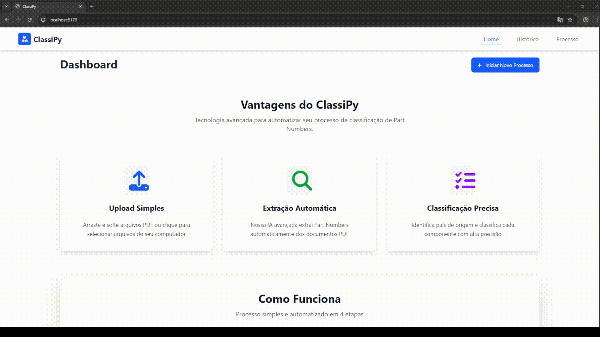
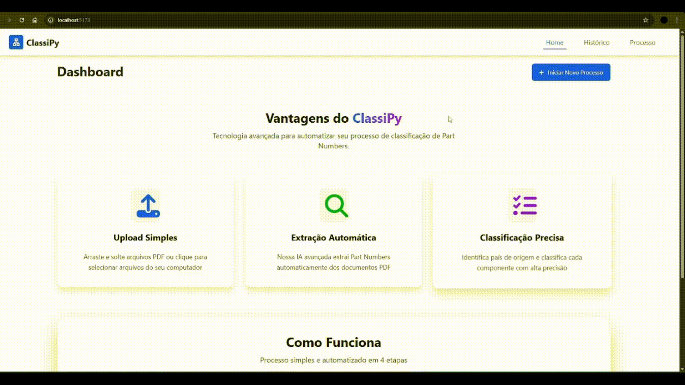
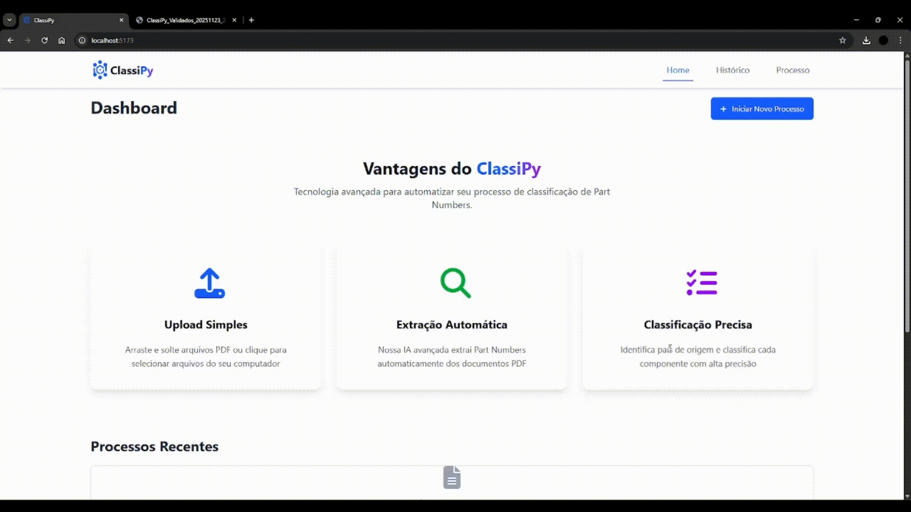

# 👨‍💻 Vinicius Elias Carvalho Ribeiro

Sou Técnico de Informática formado pelo Colégio Joseense, atualmente estudante de Análise e Desenvolvimento de Sistemas na Fatec de São José dos Campos, no 5º semestre. Escolhi a Fatec por acreditar que era uma boa opção para construir minha carreira no mercado de trabalho. Tenho interesse na área de programação, particularmente backend e análise de dados, e venho desenvolvendo minhas habilidades em tecnologias como Python, Typescript, React, Node, bancos relacionais e não relacionais, Pacote Office e PowerBI.

Atualmente não tenho estágio, mas sigo buscando oportunidades profissionais enquanto desenvolvo minhas qualidades técnicas e pessoais através de projetos acadêmicos, aprendendo não só tecnologias, mas habilidades como gestão de equipes e projetos, análise de informações, arquitetura de projetos, comunicação e resolução de conflitos.

## 📸 Foto

    

## 📫 Contatos

São José dos Campos, SP  
[viniciuseliascr@gmail.com](mailto:viniciuseliascr@gmail.com)  
(12) 98887-2563  
[GitHub – ViniElias](https://github.com/ViniElias)  
[LinkedIn – Vinicius Elias Carvalho Ribeiro](https://www.linkedin.com/in/viniciuseliasdev/)

## 🧠 Conhecimentos

### Linguagens de Programação
- Python  
- Java  
- JavaScript  
- TypeScript

### Frontend
- React
- HTML
- CSS
- Tailwind
- Nativewind
- Bootstrap

### Backend
- Node.js
- Flask
- FastAPI
- Swagger

### Banco de dados
- MySQL
- PostgreSQL
- MongoDB

### DevOps e Tecnologias
- Git e Github
- AWS
- Ollama
- Google Colab
- VirtualBox
- Docker

### Outros 
- Pacote Office
- PowerBI
- Inglês avançado
- Metodologia SCRUM

# 💼 Meus Projetos

## Scrum Academy - 2024 - 1º Semestre  

## Empresa Parceira  
O projeto foi desenvolvido em parceria com a **FATEC São José dos Campos – Prof. Jessen Vidal**, com o objetivo de desenvolver uma aplicação web que dissemine eficientemente todas as informações relevantes sobre os processos e artefatos da metodologia ágil (SCRUM), de modo que o conteúdo esteja claro e possa ser compreendido por quaisquer usuários. 

## Problema  
Durante o curso, foi identificado que muitos alunos e profissionais ainda encontravam dificuldades em entender e aplicar a metodologia Scrum de forma prática. Apesar do grande uso do Scrum no mercado, seu aprendizado normalmente é restrito a aulas teóricas ou exemplos pouco dinâmicos. Isso gerava um problema de baixa assimilação dos papéis, cerimônias e artefatos do método ágil, dificultando a transição dos alunos para ambientes de trabalho reais.

## Solução
A equipe desenvolveu o Scrum Academy, uma aplicação web interativa e responsiva projetada para modernizar o ensino da metodologia Scrum. O principal objetivo da plataforma foi transformar o aprendizado teórico da metodologia ágil em uma experiência dinâmica e intuitiva, conectando a teoria à simulação prática.

## 🔗 Repositório  
[Scrum Academy (Bug Busters)](https://github.com/Bug-Busters-F/scrum-academy)

## Tecnologias Utilizadas  

- **HTML5** 
- **CSS3** 
- **Bootstrap** 
- **Python + Flask** 
- **MySQL**
- **AWS**
- **Figma** 
- **Git + GitHub** 
- **Visual Studio Code**
  

## Contribuições Pessoais  

Durante o desenvolvimento do projeto, atuei como desenvolvedor frontend e backend, participando ativamente desde a concepção da identidade visual da plataforma até a sua otimização técnica. Fui o responsável por criar a página dedicada às ferramentas do Scrum e, principalmente, por programar a lógica do exame avaliativo do site. Além disso, trabalhei na manutenção contínua do sistema, realizando a correção de bugs e implementando melhorias de responsividade para garantir uma experiência de usuário fluida e adaptável a diferentes dispositivos.

## Hard Skills  

| Habilidade | Descrição | Nível de Proficiência |
|-------------|------------|-----------------------|
| **HTML5 / CSS3** | Criação de páginas estruturadas e estilizadas | Iniciante |
| **Bootstrap** | Uso de componentes prontos e responsividade | Iniciante |
| **Python / Flask** | Desenvolvimento de back-end e rotas dinâmicas | Iniciante |
| **Git / GitHub** | Versionamento e controle colaborativo de código | Iniciante |
| **Figma** | Criação de protótipos e design de interface | Iniciante |
| **Metodologias Ágeis (Scrum)** | Planejamento e facilitação das sprints | Intermediário |

## Soft Skills  

**Trabalho em Equipe** - Colaborei com o time de desenvolvimento, garantindo integração eficiente entre front-end e back-end.
**Comunicação** - Mantive alinhamento constante com os demais membros e com o Product Owner.
**Organização** - Contribuí na estruturação do repositório e documentação do projeto.
**Resolução de Problemas** - Atuei ativamente na correção de bugs e otimização de componentes da interface.
**Proatividade** - Busquei propor melhorias nas funcionalidades e na usabilidade do sistema.

## Demonstração do Projeto

  
  

  
  

---

## 🚗 Alplaca – 2024 - 2º Semestre  

## Empresa Parceira  
O projeto foi desenvolvido em parceria com a **FATEC São José dos Campos – Prof. Jessen Vidal**, com o objetivo de criar um software para automatizar a extração de informações de documentos.

A FATEC atuou como cliente e parceira acadêmica, propondo o desafio de desenvolver um software para automatizar a extração de informações de documentos usando modelos de linguagem e visão.

## Problema  
Muitas empresas lidam com milhares de documentos diariamente, como currículos, contas, notas fiscais e assim por diante. Porém, extrair informações destes documentos é uma atividade difícil que depende da atividade humana (mais lenta que computadores) pois apenas retirar o texto pode não ser suficiente visto que as informações dependem do layout visual.

O problema identificado foi a necessidade de uma interface inteligente e intuitiva que permitisse extração de informações de forma fácil e automatizada.

## Solução 
A equipe desenvolveu uma interface gráfica em Java, integrada a modelos de Inteligência Artificial para a automação e extração de dados estruturados. Em vez de depender do processamento puramente textual ou da análise humana, o sistema utiliza o reconhecimento visual para interpretar o layout de imagens e capturar, com precisão, as informações contidas em placas de veículos submetidas pelos usuários. Após a análise computacional e a interpretação dos caracteres, a aplicação consolida e armazena automaticamente todos os dados extraídos em um banco de dados relacional, eliminando gargalos operacionais e transformando registros visuais em informações estruturadas de forma rápida e segura.

## 🔗 Repositório
[Alplaca (Bug Busters)](https://github.com/Bug-Busters-F/alplaca)

## Tecnologias Utilizadas  

- **Java** 
- **MySQL**
- **Ollama**
- **Figma**
- **Git + GitHub**
- **IntelliJ**  
- **NetBeans**

## Contribuições Pessoais  
Atuei em uma frente híbrida entre a liderança de equipe e o desenvolvimento técnico, assumindo o papel de **Scrum Master**. Nessa posição, fui responsável por coordenar a administração e organização geral do projeto, facilitando a comunicação interna para garantir o ritmo das entregas. Na parte técnica, liderei o desenvolvimento da interface gráfica em Java e assumi a engenharia de prompts, criando e testando as instruções enviadas à IA para assegurar a máxima precisão no reconhecimento dos dados das placas.

O exercício das minhas soft skills foi fundamental para o sucesso do projeto, exigindo inteligência emocional, mediação e resiliência em momentos críticos. Em um impasse técnico sobre a integração do sistema que ameaçava o cronograma da Sprint, utilizei a escuta ativa para gerenciar o conflito e direcionar o grupo a um consenso produtivo.

## Hard Skills  

| Habilidade | Descrição | Nível de Proficiência |
|-------------|------------|-----------------------|
| **Java** | Desenvolvimento back-end e integração com IA | Iniciante |
| **MySQL** | Modelagem, consultas e integração de dados | Intermediário |
| **Ollama** | Criação e execução de agentes de IA locais | Iniciante |
| **Figma** | Prototipagem de interfaces e fluxos de chatbot | Intermediário |
| **Git + GitHub** | Versionamento e colaboração em equipe | Intermediário |
| **Scrum + Metodologias Ágeis** | Planejamento e acompanhamento de sprints | Avançado |

## Soft Skills  

**Resolução de Problemas** - Superei desafios técnicos na integração de modelos de IA com a interface desktop.
**Liderança** - Como Scrum Master, coordenei as tarefas e incentivei o engajamento da equipe, mantendo o foco nas metas das sprints.
**Trabalho em Equipe** - Colaborei ativamente com o time de desenvolvimento para alinhar o front-end às necessidades do back-end.
**Atenção aos Detalhes** - Garantida através da implementação de testes rigorosos para evitar falhas em dados sensíveis.
**Adaptabilidade** - Aprendizado rápido de novas ferramentas como o Ollama para atender ao requisito de processamento local.

## Demonstração do Projeto

---

## 📊 Alfalog - 2025 - 1º Semestre 

## Empresa Parceira  
O projeto Alfalog foi desenvolvido em parceria com o professor **Marcus Nascimento, coordenador do curso de Logística da FATEC São José dos Campos – Prof. Jessen Vidal**.

O objetivo deste projeto foi desenvolver uma plataforma web que disponibilize informações sobre o desempenho dos Estados Brasileiros no comércio exterior, com base nos dados abertos do Ministério do Desenvolvimento, Indústria, Comércio e Serviços.

## Problema  
Economistas, gestores públicos e empresas enfrentam desafios para acompanhar e analisar os resultados do comércio exterior brasileiro de forma eficiente. A dispersão de informações brutas dificulta a identificação de tendências de mercado, impactando negativamente a tomada de decisão ágil baseada em dados reais de importação e exportação.

O problema identificado foi a necessidade de uma plataforma web que permitisse organizar, estruturar e visualizar os dados abertos governamentais de forma clara e acessível, auxiliando na identificação de estados e municípios em ascensão, estagnação ou declínio no mercado internacional.

## Solução Entregue  
A equipe desenvolveu a Alfalog, uma plataforma interativa de acompanhamento e análise de desempenho no comércio exterior. A ferramenta permite que os tomadores de decisão filtrem informações estratégicas, identifiquem padrões logísticos e visualizem resultados em dashboards interativos baseados nos dados abertos do MDIC.

O sistema foi desenvolvido com uma arquitetura robusta e banco de dados relacional, garantindo a qualidade, limpeza e disponibilidade das informações para análise. Entre as principais funcionalidades estão:

- Visualização de estatísticas detalhadas da balança comercial (importação e exportação) por estado;
- Exportação de dados e insights estruturados para análises profundas em ferramentas externas (como Excel).
- Filtros avançados por período histórico (2014-2024), setor econômico, código NCM e meios de transporte;
- Geração de gráficos, mapas interativos de fluxo de exportação e relatórios de desempenho;

## 🔗 Repositório
[Alfalog (Bug Busters)](https://github.com/Bug-Busters-F/Alfalog)

## Tecnologias Utilizadas  

- **React** 
- **TypeScript** 
- **Python + Flask**  
- **MySQL**
- **HTML5 + CSS3** 
- **Git + GitHub** 
- **Visual Studio Code**  
- **Figma**
- **Jira**  

## Contribuições Pessoais  
Atuei como desenvolvedor fullstack no projeto Alfalog, participando ativamente desde a infraestrutura até a interface do sistema. Fui responsável pelo desenvolvimento da página inicial e da página de pesquisa da plataforma, além de trabalhar diretamente no tratamento e na modelagem dos dados brutos do MDIC para o banco de dados relacional. Essa etapa de preparação dos dados foi essencial para garantir que as informações de importação e exportação fossem filtradas e estruturadas corretamente, servindo de base para a geração dos gráficos e relatórios da aplicação.

O projeto exigiu grande resiliência e disciplina, pois precisei dominar conceitos complexos que eram totalmente novos para mim na época, como a manipulação de grandes volumes de dados e a lógica por trás dos códigos NCM e fluxos logísticos. Diante da dificuldade inicial em tratar dados tão extensos e dispersos sem comprometer o desempenho do sistema, mantive o foco nos estudos extra-classe, testando diferentes abordagens de limpeza e otimização de queries até alcançar o resultado esperado. Essa dedicação para superar a curva de aprendizado sob pressão foi fundamental para entregar uma ferramenta de pesquisa funcional e garantir a consistência das informações apresentadas nos dashboards.

## Hard Skills  

| Habilidade | Descrição | Nível de Proficiência |
|-------------|------------|-----------------------|
| **React + TypeScript** | Desenvolvimento de interfaces, dashboards e componentes dinâmicos | Iniciante |
| **Python + Flask** | Construção da API, regras de negócio, integração com banco, ETL dos dados | Intermediário |
| **MySQL** | Modelagem de dados relacionais e elaboração de consultas complexas | Intermediário |
| **HTML + CSS** | Estruturação e estilização de páginas web responsivas | Avançado |
| **Figma** | Criação e prototipagem de interfaces (UI/UX) | Avançado |
| **Git + GitHub** | Versionamento de código | Intermediário |
| **Scrum + Metodologias Ágeis** | Planejamento e acompanhamento de sprints | Avançado |

## Soft Skills  

**Trabalho em Equipe** - Colaborei com o time de desenvolvimento, garantindo integração eficiente entre front-end e back-end.
**Comunicação** - Mantive alinhamento constante com os demais membros e com o Product Owner.
**Organização** - Contribuí na estruturação do repositório e documentação do projeto.
**Resolução de Problemas** - Atuei ativamente na correção de bugs e otimização de componentes da interface.
**Proatividade** - Busquei propor melhorias nas funcionalidades e na usabilidade do sistema.

## Demonstração do Projeto

  
  

  

---

## 📊 ClassiPy - 2025 - 2º Semestre

## Empresa Parceira  
O projeto ClassiPy foi desenvolvido como parte do curso de Análise e Desenvolvimento de Sistemas da FATEC São José dos Campos – Prof. Jessen Vidal, em parceria com a **TecSys**.

O objetivo principal foi desenvolver um agente de Inteligência Artificial inovador capaz de automatizar a elaboração da instrução de registro aduaneiro, incorporando de forma inteligente dados críticos como Part-Number, classificação fiscal, fabricante, origem e endereço do fabricante.

## Problema  
O processo manual de elaboração de registros aduaneiros para materiais produtivos, especialmente na indústria eletroeletrônica, é complexo e suscetível a erros. É necessário relacionar informações como Part-Number, classificação fiscal (NCM), fabricante e origem com endereço completo, gerando uma descrição detalhada do material. Qualquer ambiguidade ou erro nessas informações pode gerar dúvidas para a Receita Federal, acarretando penalidades e multas sobre a declaração do material importado.

## Solução
ClassiPy - Classificação Inteligente de Produtos, é uma aplicação web projetada para resolver o problema, automatizando e otimizando o processo de instrução de registro aduaneiro. A solução permite que o usuário faça o upload de um pedido de compras em formato PDF. A partir do documento, o agente de IA extrai todos os Part-Numbers e, para cada um, realiza uma busca inteligente para sugerir a classificação fiscal completa, incluindo descrição detalhada do produto, NCM, fabricante e mais.

## 🔗 Repositório  
[ClassiPy (Bug Busters)](https://github.com/Bug-Busters-F/ClassiPy)

## Tecnologias Utilizadas  

- **React**  
- **TypeScript**
- **PostgreSQL** 
- **Node.js**
- **Ollama**
- **Docker**
- **Vite**
- **Python + FastAPI** 
- **Jira**  
- **Git + GitHub**
- **Visual Studio Code** 

## Contribuições Pessoais  
Atuei no desenvolvimento do ClassiPy com foco na estruturação do backend e na manipulação de dados para garantir a confiabilidade do processo aduaneiro. Minhas principais responsabilidades envolveram a criação das rotas do CRUD no servidor, assegurando o fluxo correto de armazenamento e edição das informações, e o tratamento dos dados extraídos pela inteligência artificial. Além disso, desenvolvi o código responsável por exportar os dados já validados para planilhas Excel, permitindo que o usuário final gerasse a instrução de registro de forma automatizada e livre de erros manuais.

Esse projeto exigiu bastante disciplina e resiliência, pois lidar com regras de validação estritas e com a formatação precisa de arquivos Excel via código foi um desafio técnico complexo para o meu nível de conhecimento na época. Diante de erros iniciais na organização das colunas e na consistência dos dados tratados, precisei manter o foco, estudar a fundo a documentação das bibliotecas de backend e realizar múltiplos testes de mesa. Essa persistência para entender a lógica de persistência e exportação de dados foi crucial para entregar um sistema seguro e eficaz.

## Hard Skills  

| Habilidade | Descrição | Nível de Proficiência |
|-------------|------------|-----------------------|
| **React + TypeScript** | Desenvolvimento da interface e componentes responsivos | Intermediário |
| **Python + FastAPI** | Automação de busca e definição de dados, criação de rotas e regras de negócio | Intermediário |
| **PostgreSQL** | Modelagem e consultas de dados relacionais | Intermediário |
| **Git + GitHub** | Controle de versão e colaboração entre desenvolvedores | Avançado |
| **Scrum + Metodologias Ágeis** | Planejamento e acompanhamento de sprints | Avançado |

## 💬 Soft Skills  

**Atenção aos Detalhes** - Garanti a precisão na validação de Part Numbers e na formatação rigorosa do arquivo Excel final exigido pela Receita Federal.
**Resolução de Problemas** - Desenvolvi a lógica de scraping e estruturei fluxos complexos para lidar com dados não estruturados extraídos de PDFs.
**Trabalho em Equipe** - Colaborei para integrar as funções que desenvolvi no back-end com a interface gráfica do restante do time.
**Proatividade** - Assumi demandas de ponta a ponta (do scraping no back-end à tela no front-end), garantindo a entrega completa das funcionalidades.

## Demonstração do Projeto

  
  

  

